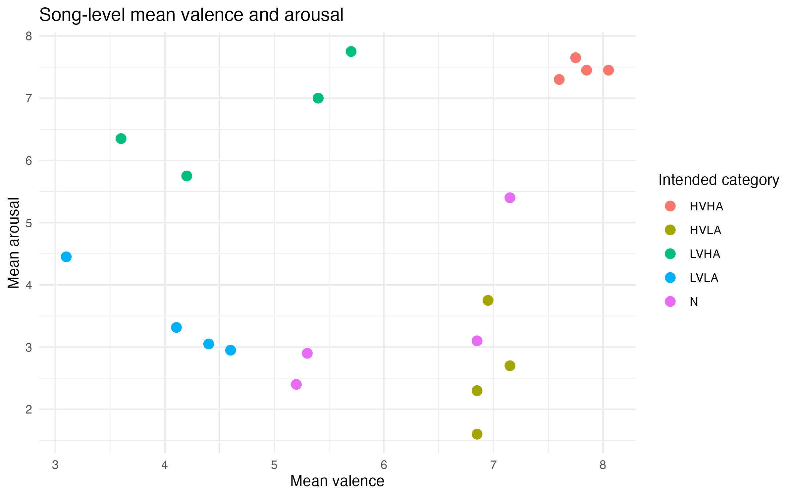
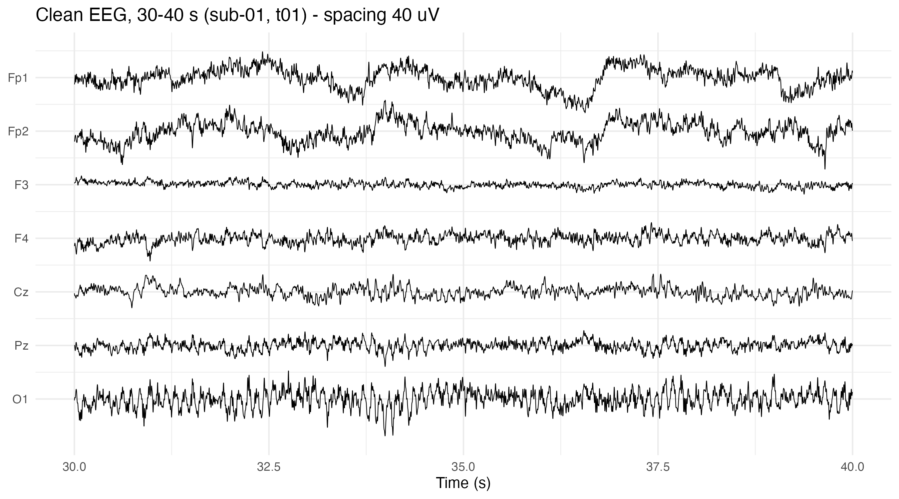
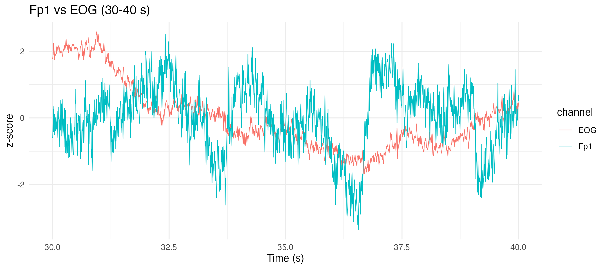
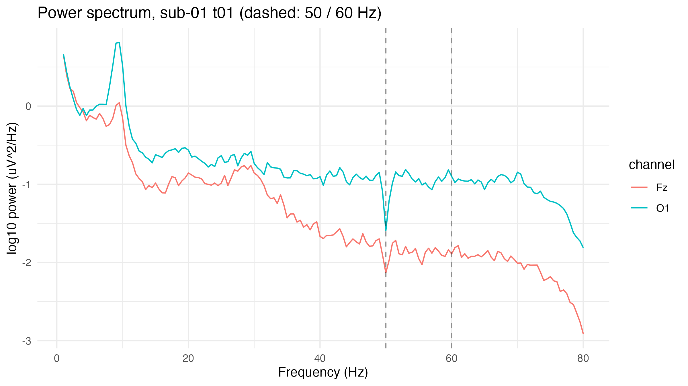
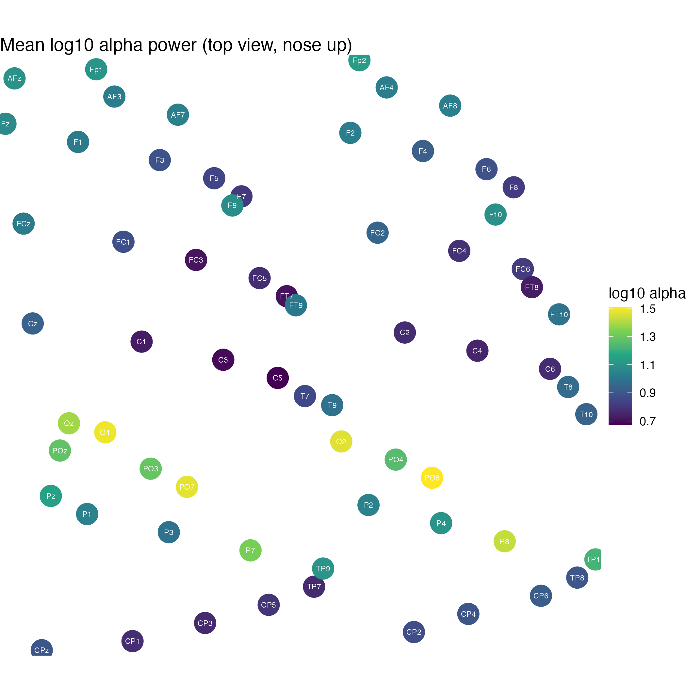
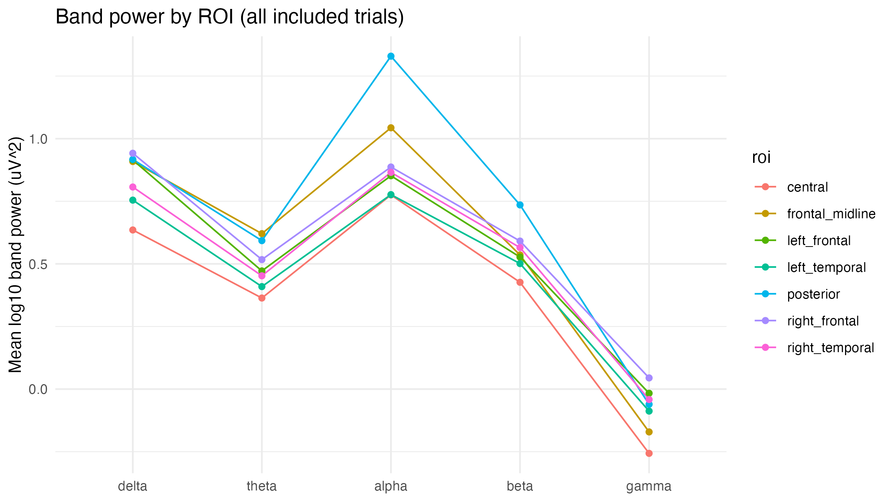
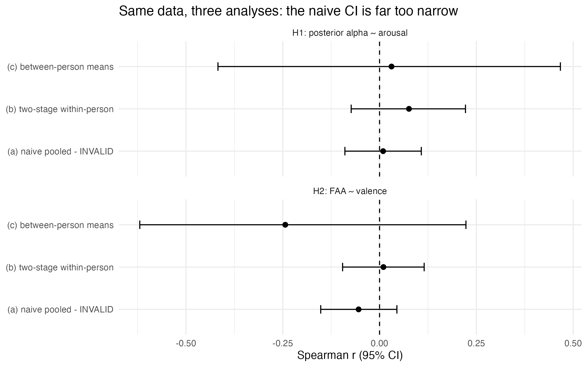
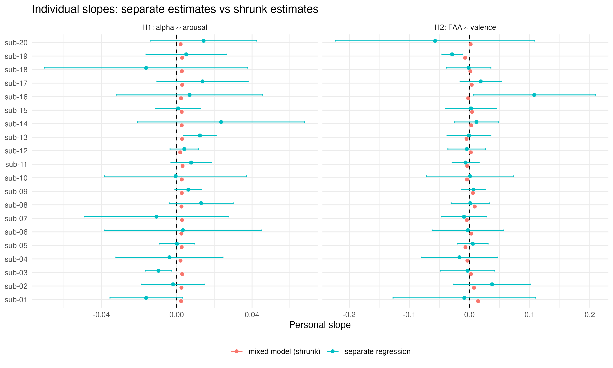
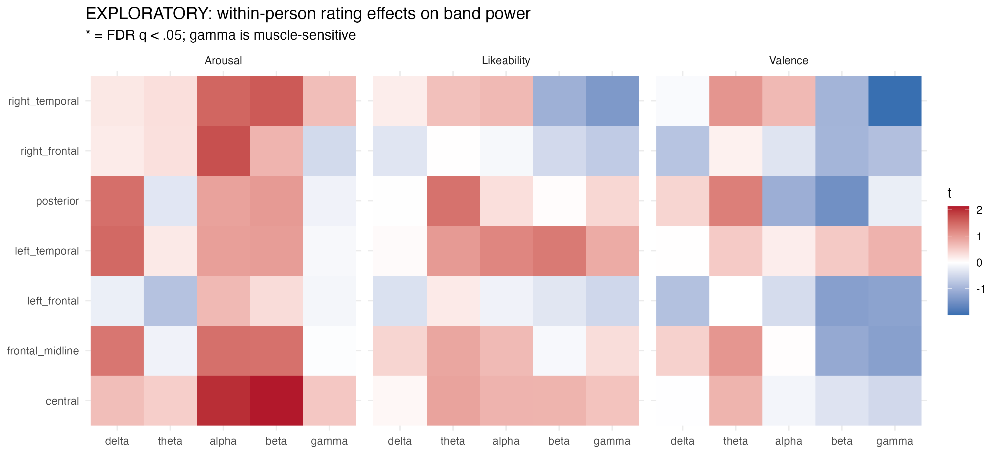
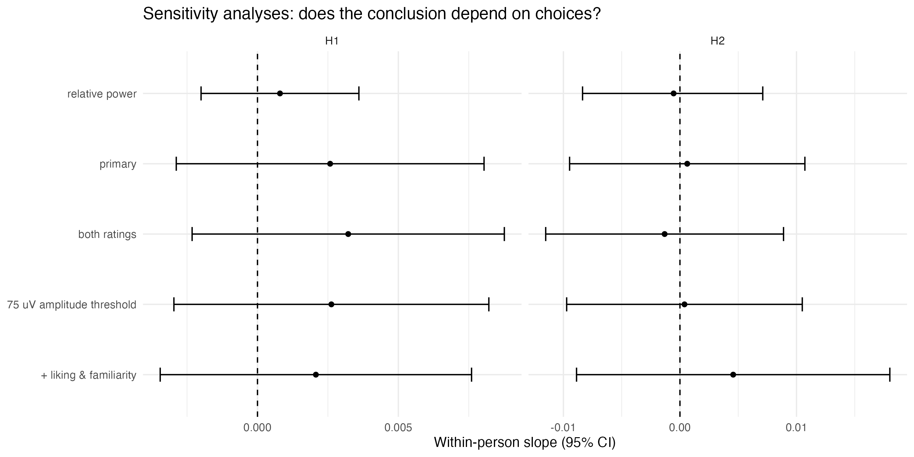

# Music, Emotion and the Brain: EEG Analysis of Subjective Experience

A preregistered within-person analysis of how self-reported emotional experience during music listening relates to scalp EEG band power, using the **MET Music-Induced EEG Dataset** (OpenNeuro ds008701).

**Status:** ✓ Complete — all phases run, results analysed, preregistration committed

---

## The Research Question

> **Within individuals, is self-reported emotional experience (valence and arousal) during 2-minute music excerpts associated with EEG band power, and does any association persist for the person-specific part of the experience, beyond what is shared across listeners for the same song?**

### Three Preregistered Hypotheses
- **H1:** Higher within-person arousal → lower posterior alpha (8–13 Hz) power
- **H2:** Higher within-person valence → greater frontal alpha asymmetry (relatively more left-frontal activity)
- **H3:** The slopes in H1 and H2 vary between participants

---

## Key Figures

### Phase 1: Song Ratings & Manipulation Check


Each dot = one song's average rating across 20 listeners. Arousal separates songs clearly; valence is compressed at the low end. Songs intended to be "negative" were mildly unpleasant at most.

**Variance in ratings:**
| Rating | Person's habit | The song | Personal reaction |
|--------|---|---|---|
| Valence | 4% | 49% | **47%** |
| Arousal | 4% | 67% | **29%** |

Songs drive 50–67% of ratings. Personal reactions are substantial, leaving room to detect person-specific EEG effects.

---

### Phase 2: Raw EEG & Preprocessing



**Top (A):** Clean EEG, ±20 µV. **Bottom (B):** Annotated bad seconds (red), reaching ~9,000 µV—excluded entirely.



Correlation between blinks (EOG) and Fp1 is weak (r ≈ −0.09), suggesting blinks were already removed upstream.

---

### Phase 3: Power Spectrum & Topography



Welch spectrum: 1/f shape typical. Alpha peaks at ~10 Hz over the back (O1, blue) and is weaker at the front (Fz, orange). Dip at 50 Hz reveals an undocumented notch filter.



Alpha (8–13 Hz) is strongest posteriorly, as expected. Validates the pipeline.



Power in each band (δ, θ, α, β, γ) across seven regions. Posterior regions have the most alpha.

**Quality control:**
| Stage | Count |
|-------|-------|
| Participant–song pairs | 400 |
| EEG files present | 399 (sub-17 t17 missing from the dataset) |
| Passed EEG quality control | 396 (excluded: sub-12 t05 truncated file, sub-14 t06 only 26 clean epochs, sub-18 t17 no clean epochs) |
| Analysable trials | **395** (also excluding sub-01 t27, missing liking and familiarity) |
| Recordings with at least one flagged channel | 213 (mostly edge sites F9, F10, T10; only 12 inside the H1 or H2 regions) |

---

### Phase 4: Statistical Analysis

#### Pseudoreplication problem: why 400 trials ≠ 400 people


Naive pooling treats all 395 trials as independent, which gives a confidence interval that is too narrow (H1: r = 0.009, 95% CI [−0.09, 0.11]). The correct two stage within person analysis treats the 20 people as the units and gives a wider, honest interval (H1: r = 0.08, 95% CI [−0.07, 0.22]). In these data no approach finds an effect; the point of the demo is the width of the interval, not the size of the statistic.

#### Individual differences in slopes (H3)


Each person's slope with 95% CI (left) and the shrunken estimates (right). The raw slopes look different from person to person, but the random slope models were singular (estimated slope SD ≈ 0.000 for H1 and 0.006 for H2), so the spread is consistent with noise from about 20 trials per person. All confirmatory models therefore used the preregistered fallback to random intercepts only.

#### Exploratory analysis (105 tests: 5 bands × 7 regions × 3 ratings, FDR corrected)


Effect sizes across all band and region pairs. Only 3 of 105 tests had uncorrected p < .05 (about 5 would be expected by chance), and the smallest FDR q value was 0.996. Any bright spots are ideas for future work, not findings.

#### Sensitivity: robustness across preprocessing choices


The main effects stay small and non significant under four alternative specifications (both ratings in one model; adding liking and familiarity; relative power; a ±75 µV threshold) and under leave one subject out estimation (H1 slope range 0.0016 to 0.0037; H2 range −0.0015 to 0.0028). The preregistered presentation order check could not be run because file timestamps repeat, so play order is not recoverable. No single decision drove the results.

---

## Results Summary

| Hypothesis | Finding | Effect size | 95% CI | p |
|---|---|---|---|---|
| **H1:** Arousal → posterior α↓ | Not supported (observed sign is opposite to the prediction) | 0.05 | [−0.05, 0.15] | 0.355 |
| **H2:** Valence → FAA↑ | Not supported | 0.01 | [−0.10, 0.11] | 0.903 |
| **H1 person specific:** arousal deviation → posterior α | Not supported | 0.05 | [−0.05, 0.15] | 0.342 |
| **H2 person specific:** valence deviation → FAA | Not supported | 0.04 | [−0.06, 0.15] | 0.386 |
| **H3 for H1:** slopes vary between people | Not supported (LR = 0.01, slope SD ≈ 0.000, singular) | n/a | n/a | 0.949 |
| **H3 for H2:** slopes vary between people | Not supported (LR = 1.15, slope SD = 0.006, singular) | n/a | n/a | 0.424 |

Effect sizes are standardized within person slopes. H3 p values use the preregistered 50:50 mixture of χ²(1) and χ²(2). All H1 and H2 models fell back to random intercepts only because the random slope structure was singular.

**Exploratory tests (105 tests):** None survive FDR correction (smallest q = 0.996).

**Consensus vs. deviation:** Effects remain null whether testing song consensus or personal deviation ratings (consensus slopes are descriptive only, because they are confounded with acoustics).

**Interpretation:** No EEG and emotion association was detected in this sample. This is not proof of no effect, but the confidence intervals make it unlikely that a one SD within person change in arousal shifts posterior alpha by more than about 0.05 SD in the predicted (negative) direction, or that a one SD change in valence shifts FAA by more than about 0.11 SD in either direction.

---

## How to Run This

### Prerequisites
R ≥ 4.0 with: tidyverse, lme4, here, readr, ggplot2, patchwork, quarto

### Get the data (not stored in this repository)
The raw EEG (about 14 GB) is public on OpenNeuro, so it is downloaded rather than kept in git. From the project folder run:

```bash
bash 00_setup/download_data.sh
```

This places OpenNeuro ds008701 version 1.0.4 (the exact version analysed) in `data/ds008701`, which `00_setup/config.R` uses by default. If you already have the dataset elsewhere, set the environment variable `MET_DATA` to its folder instead.

### Quick start
```r
# Open the project in RStudio
File > Open Project > met-eeg-project.Rproj

# Restart R
Session > Restart R

# Run everything (~15 min)
source("run_all.R")
```

### Or run phases individually
```r
# Phase 1: Ratings exploration
source(here::here("01_phase1_ratings", "01_ratings.R"))

# Phase 2: EEG inspection (one recording)
source(here::here("02_phase2_eeg_inspection", "02_eeg_inspect.R"))

# Phase 3: All 399 recordings (~10 min)
source(here::here("03_phase3_features", "03_features.R"))

# Phase 4: Statistics (requires preregistration committed)
source(here::here("04_phase4_statistics", "04_stats.R"))

# Phase 5: Final tables
source(here::here("05_phase5_report", "05_final_outputs.R"))

# Render report
quarto::quarto_render(here::here("05_phase5_report", "report.qmd"))
```

---

## Project Structure

```
met-eeg-project/
├── 00_setup/                      Dataset path & utility functions
│   ├── config.R                   Configuration (dataset path: data/ds008701 or $MET_DATA)
│   ├── download_data.sh           Downloads the raw EEG from OpenNeuro
│   └── eeg_functions.R            EEG reading, preprocessing, feature extraction
├── 01_phase1_ratings/             Rating exploration & variance decomposition
│   ├── 01_ratings.R
│   └── outputs/ → figures/, tables/
├── 02_phase2_eeg_inspection/      Understand one EEG recording
│   ├── 02_eeg_inspect.R
│   ├── PREREGISTRATION.md         (Committed in git ✓)
│   └── outputs/ → figures/, tables/
├── 03_phase3_features/            Extract features from all 399 recordings
│   ├── 03_features.R
│   └── outputs/ → band power CSVs, QC table
├── 04_phase4_statistics/          Confirmatory & exploratory analyses
│   ├── 04_stats.R
│   └── outputs/ → results tables & figures
├── 05_phase5_report/              Final results & interpretation
│   ├── 05_final_outputs.R
│   ├── report.qmd                 Quarto template
│   └── outputs/ → final_results_table.csv, interpretation_worksheet.csv
├── run_all.R                      Rebuild everything
├── README.md                      This file
├── docs/
│   ├── MET_project_overview.pdf   7 page plain language overview (written before results were seen)
│   ├── learning_guide/            Beginner learning guide (PDF, HTML source, Welch figure)
│   └── corrections_prompt.md      Review checklist used for the October 2026 corrections
├── data/                          Raw dataset, downloaded locally (ignored by git)
└── met-eeg-project.Rproj
```

---

## Key Methods

### Within-person analysis (avoiding pseudoreplication)
- Rating = song-consensus + personal-deviation
- Tests personal-deviation against EEG to isolate subjective experience from stimulus acoustics
- Mixed-effects models with random intercepts per person and per song

### Preregistration
All hypotheses and analysis choices are in `02_phase2_eeg_inspection/PREREGISTRATION.md`, committed to git (commit 3f16cb2, 6 Oct 2026 15:27 IST) before `04_stats.R` was run. The file still carries its original "Status: DRAFT" header; it has deliberately not been edited after the commit, so the committed version is the authoritative preregistration.

**Deviations from the preregistration:** (1) all H1 and H2 models used the preregistered singular fit fallback (random intercepts only); (2) the presentation order sensitivity analysis (item 3) could not be run because acq_time values repeat; (3) H3 slope SD confidence intervals could not be computed because the random slope models were singular.

### Multiple comparisons
- Confirmatory (H1, H2): Bonferroni α = .025
- Exploratory (105 tests): Benjamini–Hochberg FDR α = .05

---

## Limitations

1. Small sample (N=20) with noisy individual estimates
2. Assumed music onset (5 s + 120 s; no onset marker in data)
3. Post-hoc single ratings per excerpt (moment-to-moment emotion invisible)
4. Song set skewed toward mild valence
5. Inherited upstream preprocessing (filtering, notch, possible ICA)
6. Scalp-level EEG is spatially blurry
7. Correlation ≠ causation
8. One recording (sub-12 t05) is truncated in the published dataset itself (62% of samples), and another (sub-17 t17) is missing
9. Dataset metadata errors: files are EEGLAB `.set`, not BrainVision as the dataset README says; `channels.tsv` lists units as V although values are µV; flat channels are labelled "good"; a 50 Hz notch is undocumented
10. Presentation order is not recoverable, so order and fatigue effects cannot be controlled

---

## Reproducibility

Rebuild from scratch:
```r
Session > Restart R
source("run_all.R")
```

The preregistration is committed. All code and data are versioned. Results are final.

---

## References

- **Data:** Cheang, W. L. (2026). *MET: Music-Induced EEG Dataset* (v1.0.4). OpenNeuro. doi:10.18112/openneuro.ds008701.v1.0.4
- **Mixed-effects models:** Bates et al. (2015). *Journal of Statistical Software*, 67(1).
- **Frontal alpha asymmetry:** Coan, J. A., & Allen, J. J. B. (2004). *Biological Psychology*, 67(1–2), 7–49.
- **Pseudoreplication:** Barr et al. (2013). *Journal of Memory and Language*, 68(3).

---

**Author:** Aditya Koundinya  
**Contact:** aditya003koundinya@gmail.com  
**License:** Creative Commons Attribution 4.0 International  
**Last updated:** October 2026
